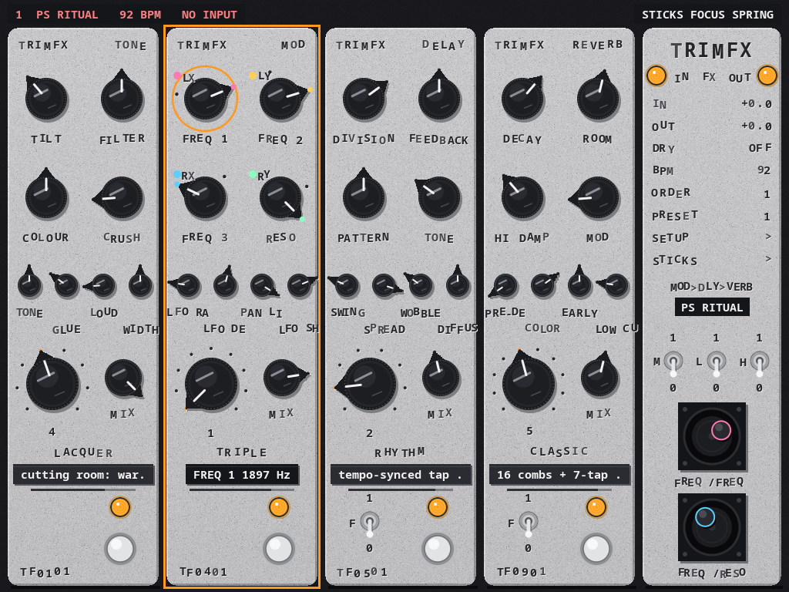
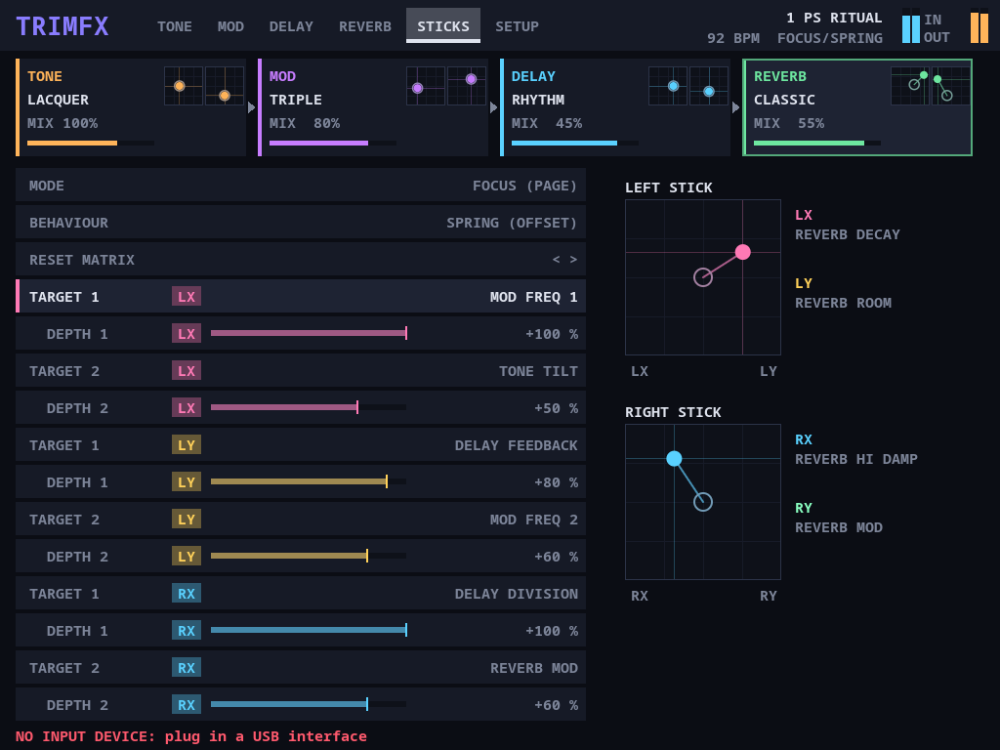
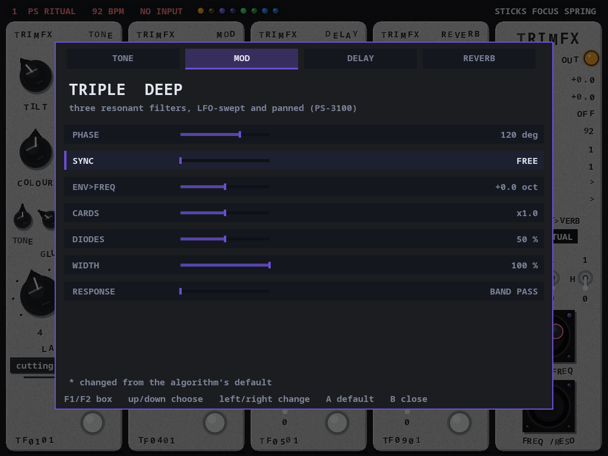

# TrimFX

A four-module FX chain for the **TrimUI Brick Pro**, built for a **USB FX send**: plug a USB
audio interface into the top port, send into its input, take the return from its output.
Both analog sticks play the effects as two X/Y pads. It also runs on the Brick and Brick
Hammer, which have no sticks, so you play the knobs with the buttons there.

```
USB in -> TONE -> MOD -> DELAY -> REVERB -> USB out
          (mastering    (unusual   (granular,   (90s-style
           / character)  modulation) rhythmic,   algorithms)
                                     reverse...)
```



**Status: 0.1.0 dev.** The engine is tested on the host (every algorithm, `make test`), and the
app builds for MustardOS. It has **not yet run on Brick hardware.**

- Every module has several **algorithms** (L2 / R2). Each algorithm has its own controls, and each
  remembers its settings.
- Every module's **MIX** goes to **100 % wet**, with no dry at all, and **MASTER > DRY**
  defaults to off. The return carries only the effect.
- **DELAY and REVERB bypass with trails**: the input closes and the tail rings out.
- **FREEZE**: L3 holds the delay, R3 holds the reverb, forever, with the input closed.
- The chain order of MOD, DELAY and REVERB can be changed (MASTER > ORDER). TONE always comes
  first.

## The sticks: dual X/Y

Each algorithm has 8 parameters. **The first four are the PERFORM set** and sit on the sticks:

| | X (left / right) | Y (down / up) |
|---|---|---|
| **Left stick** | P1 (LX) | P2 (LY) |
| **Right stick** | P3 (RX) | P4 (RY) |

- **FOCUS** mode (the default) puts the sticks on the selected pedal's four knobs. On MASTER they
  stay on the last pedal.
- **MATRIX** mode (B) puts each axis on up to **two parameters anywhere in the chain**, each
  with its own depth (-100 % to +100 %). For example, LX could open the resonators and darken
  the tone at once, and RY could lengthen the reverb and push its mix. Set this up on the
  STICKS overlay.
- **SPRING** (the default) gives an offset while you push, and the value springs back when you
  let go. **LATCH** (X) drags the stored setting itself, which stays where you leave it.
- **HOLD** (Y) freezes the sticks where they are, so you can let go and keep the sound.

On screen, the selected pedal's **two X/Y pads** sit under the board: a ring shows the stored
setting, a dot shows where the sticks have taken it, and a line joins them. Every knob and
slider on every pedal shows its stored value and its live one, so you see each effect's position
at once. On the Brick Pro, the stick rings light up as you push.

## The pedalboard

Everything is on one screen: a board of raw-aluminium boxes with hand-stamped lettering, in signal order:
- **Four pedals**: TONE, MOD, DELAY and REVERB.
- **A master box**: IN and OUT gain, DRY, TEMPO, ORDER and PRESET, the IN / OUT lights, three mini toggles
  for the sticks (M matrix, L latch, H hold) and the two joysticks.

Each pedal has:
- **four big knobs**: the PERFORM set, on the sticks
- **four small knobs**: the DEEP set
- a big **ALGORITHM** selector knob, with a punched dot for each position
- a **MIX** knob
- a **Dymo-tape readout** of what you are turning
- an amber **LED** with a ribbed lens: lit when on, dark when bypassed, blue when frozen
- on DELAY and REVERB, a mini **F toggle** that shows FREEZE (L3 / R3)
- a chrome **footswitch**

Each knob's pointer shows the live value. A punched dot on the metal marks the stored setting, and
a dot in the stick's colour appears while a stick moves it. The master box draws the **two
joysticks** (gimbal, boot, the stick leaning where you push it) and names what they move.

Devices, save / load / factory presets and the stick matrix are in two **overlays**. Open them
from MASTER > SETUP or STICKS, or with HOME on the Brick Pro.

| Button | Action |
|---|---|
| F1 / F2 | Previous / next pedal (then MASTER), so the shoulder buttons are never needed. In an overlay: switch between SETUP and STICKS |
| L1 / R1 | The same as F1 / F2 |
| D-pad ↑↓ | Choose a control on the pedal: ALGORITHM, the 4 knobs, the 4 sliders, MIX |
| D-pad ←→ | Turn it (hold to speed up). On ALGORITHM: change the algorithm |
| A | The pedal's footswitch (bypass). On ALGORITHM: open its DEEP page. On MASTER rows: open SETUP / STICKS, save to the slot |
| B | Sticks: FOCUS ↔ MATRIX (in an overlay: close it) |
| X | Sticks: SPRING ↔ LATCH |
| Y | HOLD the sticks |
| L2 / R2 | Previous / next algorithm of the selected pedal (or choose ALGORITHM and use ←→) |
| L3 / R3 | FREEZE the delay / the reverb |
| SELECT | Tap tempo (RHYTHM, STUTTER). Hold for a second: MIDI LEARN on / off |
| START | Save to the current preset slot |
| HOME | Open / close SETUP (Brick Pro) |
| MENU | Quit (the state is saved and comes back next time) |



## The lights (Brick Pro)

The Brick Pro's LEDs follow the effects. The top of the screen and the joysticks on MASTER show the
same lights.

- **Stick rings:** where each stick's two parameters are now, sticks included. The corner nearest
  the X/Y point glows brightest, in the colour of the box the stick plays. They breathe while HELD.
  On screen, a cross-hair inside each joystick marks the same point.
- **Top bar:** the chain in signal order, two lights per box. Each pair is that box's wet level as a
  two-step meter over a faint glow (brighter for the box on screen). A pair is dark when its box is
  bypassed (dim red if it is the box on screen) and pulses white when the box is frozen. The two ends
  flash red when the output nears clipping. `TFX_LED_BAR=meter` in `launch.sh` brings back the plain
  output meter.
- **F1 / F2:** the colours of the boxes they step to.
- **Shoulders:** the beat, at the tempo.

## MIDI control (Korg nanoKONTROL Studio)

Plug a USB MIDI controller in (through a hub, with the audio interface) and it is picked up within two
seconds. The **TRIMFX template** for the Korg nanoKONTROL Studio puts 36 controls on hardware: the
8 knobs are the eight parameters of a box, the 8 faders are the four MIXes, IN, DRY, OUT and TEMPO,
and the buttons are the footswitches, freezes, algorithm steps, pages, presets, tap and save.
Scene 1 follows the page on screen; scenes 2-5 are TONE, MOD, DELAY and REVERB, so all 32 parameters
are a scene change away. Any controller can be mapped with **MIDI LEARN**: hold SELECT, choose a
control on the board (or press A for the footswitch, L3 / R3 for freeze...), move a MIDI one; on to
the next, B when done. See [docs/midi.md](docs/midi.md).


## The modules

The first four parameters of every algorithm, in **bold**, are on the sticks.

### TONE: mastering and character

| Algorithm | Parameters | What it is |
|---|---|---|
| LONDON | **TILT, FILTER, COLOUR, CRUSH**, TONE, GLUE, LOUD, WIDTH | 60s studio master: warm shelves, slow tube glue, transformer |
| PUNCH | same | NY punch: big lows, fast bus compressor, parallel squash, clipper |
| CLEAN | same | modern: tilt, 3-band glue, saturated air band |
| LACQUER | same | cutting room: warm curve, mono bass, tamed top |
| CASSETTE | **SATURATE, WOW, AGE, DROPOUT**, TILT, HISS, BIAS, WIDTH | worn tape |
| SAMPLER | **BITS, RATE, FILTER, RESO**, DRIVE, JITTER, TILT, WIDTH | old 12-bit sampler: aliasing, jittery clock, resonant filter |
| TUBE | **DRIVE, WARMTH, AIR, SAG**, BIAS, MIDS, TILT, WIDTH | asymmetric triode stage that breathes under load |
| FOLD | **FOLD, SYMMETRY, TONE, BLEND**, RECTIFY, SUB, TILT, WIDTH | wavefolder, rectifier, sub-octave |

The four mastering chains are the engine from [SP-1 Master](https://github.com/sydilaxe/SP-1Master-dev).
Each runs a look-ahead limiter, and FILTER / CRUSH come from its crush page.

### MOD: unusual modulation

| Algorithm | Parameters | What it is |
|---|---|---|
| TRIPLE | **FREQ 1, FREQ 2, FREQ 3, RESO**, LFO RATE, LFO DEPTH, PAN LINK, LFO SHAPE | Korg PS-3100 / 3200-style resonators (below) |
| BARBERPOLE | **SPEED, RESO, DEPTH, STEREO**, STAGES, CENTRE, DRIFT, NOTCH | an endless phaser: the notches rise (or fall) forever |
| SPIRAL | **SHIFT, FEEDBACK, TIME, SPREAD**, LFO RATE, LFO DEPTH, TONE, RING | a frequency shifter in a feedback delay: each repeat shifts again |
| CHOIR | **VOWEL, RATE, DEPTH, RESO**, THROAT, DRIFT, DRIVE, STEREO | an a-e-i-o-u formant morph that breathes and drifts |
| DRIFT | **DEPTH, RATE, VOICES, SPREAD**, WANDER, FEEDBACK, TONE, BASE | six wandering tape voices |
| ORBIT | **SPEED, RADIUS, SHAPE, SATELLITE**, DISTANCE, WIDTH, WOBBLE | the sound circles you, with Doppler, distance and a counter-rotating satellite |
| LIQUID | **SPEED, INTENSITY, THROB, VIBRATO**, CENTRE, FEEDBACK, STEREO, WARMTH | a photocell vibe whose lamp glows and fades unevenly |
| TIDE | **RATE, DEPTH, ENV>RATE, HARMONIC**, CROSSOVER, SHAPE, PAN, ENV>DEPTH | a harmonic tremolo that speeds up (or deepens) as you play harder |
| STRINGS | **Q, FEEDBACK, SPECTRUM, SCAN**, SCAN RATE, STEREO, WARP, VACTROL | Jürgen Haible's String Filter: 40 fixed band-passes (below) |

**TRIPLE** follows the PS-3100 / 3200 resonators:
- Three resonant band-passes in parallel. Each resonator's resonance is held back by a soft,
  diode-like limit, as in the KORG-35 filters on the PS-3200 voice card.
- Each resonator is voiced a little differently, after the card's COLOR resistors
  (120k / 100k / 82k).
- One LFO sweeps all three, a third of a cycle apart. The **same LFO value moves each resonator's
  place in the stereo field**, by the **PAN LINK** amount:
  - 0: they sit fixed left, centre and right.
  - Positive: the pan follows the sweep.
  - Negative: the pan moves against the sweep.
- LFO shapes: sine, triangle, square, sample-and-hold, drift.

**STRINGS** follows the board files of Jürgen Haible's String Filter:
- **40 fixed band-passes** at the two boards' printed centre frequencies, interleaved: 43.5, 50.4,
  58.4, 67.8 … 11980, 13890 Hz. That is one band every ~2.6 semitones.
- **Odd bands go to one side and even bands to the other**, as the two boards come out separately.
  STEREO sets how far apart the sides are.
- **One Q for the whole bank**, as the LM394-controlled Q_CV sets it on the board.
- **FEEDBACK** runs round the bank (the board's Feed input), held by a **vactrol-like limiter**
  (the VTL5C3): quick to grab, slow to let go.
- Two additions that aren't on the board:
  - **SCAN** moves a formant window across the bands.
  - **WARP** scales all forty frequencies together.

### DELAY

| Algorithm | Parameters | What it is |
|---|---|---|
| GRANULAR | **TIME, FEEDBACK, PITCH, DENSITY**, SIZE, SPRAY, REVERSE, SPARKLE | a grain cloud from the delay memory: pitch, spray, reverse grains, octave sparkle |
| RHYTHM | **DIVISION, FEEDBACK, PATTERN, TONE**, SWING, SPREAD, WOBBLE, DIFFUSE | tempo-synced tap patterns, from echo and ping-pong to clave, euclid and cascade |
| REVERSO | **TIME, FEEDBACK, DIRECTION, SMEAR**, DRIFT, TONE, SPREAD, SWELL | forward and reverse heads: the repeats flip direction, smear and swell |
| TAPE | **TIME, FEEDBACK, HEADS, WOW**, FLUTTER, AGE, DRIVE, SPREAD | a three-head tape echo; feedback past unity is caught by the tape |
| SHIMMER | **TIME, FEEDBACK, INTERVAL, SHIFT**, TONE, DIFFUSE, SPREAD, DRIFT | every repeat climbs (or falls) an interval |
| CLOUD | **TIME, FEEDBACK, DIFFUSION, MOD**, TONE, SPREAD, BLOOM, DUCK | four cross-coupled wandering echoes that bloom into haze and duck as you play |
| STUTTER | **DIVISION, CHANCE, REPEATS, PITCH**, REVERSE, DECAY, GATE, SPREAD | a beat-repeat that catches slices on the grid, pitches them and flips them |
| DUB | **TIME, FEEDBACK, FILTER, RESO**, TYPE, DRIVE, SPREAD, WOBBLE | a dub echo through a filter that morphs from low-pass to band-pass to high-pass |
| PRISM | **TIME, FEEDBACK, SPREAD, TILT**, PAN, DIFFUSE, DRIFT, WIDTH | the repeats split into four bands, each with its own time: lows late and highs early (or the other way), so each echo smears apart into its colours |
| ERODE | **TIME, FEEDBACK, ERODE, GRIT**, TONE, DROPOUTS, SPREAD, WOBBLE | a failing digital memory: each pass is sampled slower, keeps fewer bits and drops out now and then, so the repeats crumble into dust |

### REVERB: late-80s / 90s algorithms

Every algorithm except MIDIVERB has **PRE-DELAY** (up to 500 ms) and **COLOR**. COLOR sets the
converters' era: 70s (narrow band, few bits), 80s, 90s, then NOW (full band).

| Algorithm | Parameters | What it is |
|---|---|---|
| CONCERT | **DECAY, SIZE, DAMP, MOD**, PRE-DELAY, COLOR, BASS, DIFFUSION | a Lexicon-style figure-eight hall tank with "spin and wander" chorus |
| PLATE | same | the same tank, small, dense and bright |
| CHAMBER 8X8 | **DECAY, SIZE, DAMP, MOD**, PRE-DELAY, COLOR, EARLY, PATTERN | an early-reflection pattern (room, hall, cathedral, slapback) into an 8×8 Hadamard FDN |
| SPACE | **DECAY, SIZE, DAMP, MOD**, PRE-DELAY, COLOR, MODE, DENSITY | URSA Major Space Station-style recirculating taps: metallic, fluttering |
| CLASSIC | **DECAY, ROOM, HI DAMP, MOD**, PRE-DELAY, COLOR, EARLY, LOW CUT | 16 combs, a 7-tap early pattern and 3 diffusers |
| BLOOM | **DECAY, SIZE, DAMP**, PRE-DELAY, COLOR, DIFFUSION, TYPE | the adjustable Alesis MidiVerb II Bloom, which swells instead of starting dense |
| MIDIVERB | **TYPE, LOW CUT, HIGH CUT, WIDTH** | the MidiVerb II Bloom programs 45 / 49, emulated exactly |
| HALO | **DECAY, SIZE, DAMP, MOD**, PRE-DELAY, COLOR, SHIMMER, INTERVAL | shimmer: every pass climbs an interval |
| SPRING | **DECAY, TENSION, DAMP, WOBBLE**, PRE-DELAY, COLOR, DRIP, DRIVE | two dispersive springs: drips, wobble, tube driver |
| INVERSE | **TIME, SHAPE, DAMP**, PRE-DELAY, COLOR, DENSITY, SPREAD | non-linear: swells up (inverse) or is cut off (gated) |
| TEMPLE | **DECAY, ROOT, DAMP, DRIFT**, PRE-DELAY, COLOR, DIFFUSION, CHORD | a room tuned to a chord (octaves, fifths, minor 7, major 7, sus, whole tone, pelog, cluster) on a root from C1 to C4: the tail rings in harmony |
| NEBULA | **DECAY, SIZE, DAMP, SCATTER**, PRE-DELAY, COLOR, DENSITY, OCTAVES | a granular reverb: grains scattered from the last seconds, pitch-smeared, now and then an octave, fed back into the cloud |

## DEEP pages

Every algorithm has a **DEEP page** for the settings you set once rather than play. Choose
ALGORITHM on a box and press **A** to open it. F1 / F2 step through the four boxes; ←→ changes a setting;
**A** puts it back to its default. A `*` marks what has been changed. Each page belongs to its algorithm:
switch the algorithm and the page changes with it, and every algorithm keeps its own settings. At
their defaults the DEEP settings sound exactly as TrimFX did before they existed.

The stick matrix can also aim at a DEEP setting. So can MIDI: hold SELECT on the DEEP page to learn
one; scene 1's knobs move the DEEP page while it is open; channels 6-9 move TONE, MOD, DELAY and
REVERB's DEEP settings.

**SYNC** locks a rate (or a delay time) to the tempo: FREE, 4 / 2 / 1 bars, or a note value.
**DUCK** turns the delay's repeats or the reverb's tail down while you play, and lets them bloom
in the gaps.

| TONE | DEEP |
|---|---|
| LONDON, PUNCH, CLEAN, LACQUER | GLUE SPEED, LIMIT RELEASE (SP-1 Master's page 2), CRUSH BITS, CRUSH RATE |
| CASSETTE | WOW RATE, FLUTTER RATE, DROPOUT RATE, HEAD BUMP |
| SAMPLER | FILTER TYPE (low / band / high pass), ANTI-ALIAS, TRACK (the filter follows the rate) |
| TUBE | WARM FREQ, AIR FREQ, MID FREQ, SAG SPEED |
| FOLD | SUB TRACK, RECT BIAS, SMOOTH |

| MOD | DEEP |
|---|---|
| TRIPLE | PHASE (how far apart the three LFOs run), SYNC, ENV>FREQ (playing moves the filters), CARDS (how differently the three PS-3200 cards are voiced), DIODES (how soon the resonance is held back), WIDTH, RESPONSE (band / low / high pass) |
| BARBERPOLE | SYNC, DRIFT RATE, FB TONE |
| SPIRAL | SYNC, LOOP LOW CUT, SATURATE |
| CHOIR | SYNC, DRIFT RATE, HIGH FORMANT, BREATH (a whisper through the formants) |
| DRIFT | SYNC, SPREAD RATES, CROSS |
| ORBIT | SYNC, DARKEST, SAT RATIO |
| LIQUID | SYNC, CELLS (how unmatched the photocells are), LAMP SPEED |
| TIDE | SYNC, ENV SPEED, SLOPE |
| STRINGS | SCAN SYNC, SPLIT (odd / even as on the boards, lows / highs, all centre), SCAN WIDTH, VAC ATTACK |

| DELAY | DEEP |
|---|---|
| GRANULAR | SYNC, DUCK, ENVELOPE (bell .. flat grains), FB TONE, DETUNE |
| RHYTHM | DUCK, WOBBLE RATE, ACCENT |
| REVERSO | SYNC, DUCK, SPLICE, DRIFT RATE |
| TAPE | SYNC, DUCK, WOW RATE, FLUTTER RATE, SPACING (of the three heads) |
| SHIMMER | SYNC, DUCK, WINDOW, DRIFT RATE |
| CLOUD | SYNC, DUCK RELEASE, WANDER RATE |
| STUTTER | FADE, LOOK BACK (catch the slice 1-4 slices ago) |
| DUB | SYNC, DUCK, WOBBLE RATE |
| PRISM | SYNC, DUCK |
| ERODE | SYNC, DUCK, HISS |

| REVERB | DEEP |
|---|---|
| CONCERT, PLATE | X-OVER (where BASS takes over), SPIN RATE, WANDER, TANK DIFF, DUCK, WIDTH |
| CHAMBER 8X8 | X-OVER, LOW DECAY, DIFFUSION, WANDER RATE, DUCK, WIDTH |
| SPACE | WANDER RATE, DRIVE, DUCK, WIDTH |
| CLASSIC | WANDER RATE, DIFFUSER, STEREO, DUCK, WIDTH |
| BLOOM | DUCK, WIDTH |
| MIDIVERB | DUCK |
| HALO | X-OVER, SPIN RATE, DIFFUSION, WINDOW (the shifter's), DUCK, WIDTH |
| SPRING | LOW CUT, PAIR (the second spring's length), WOBBLE RATE, CHIRP, DUCK, WIDTH |
| INVERSE | TAPS, JITTER, DUCK, WIDTH |
| TEMPLE | SPREAD (left and right apart in pitch), DUCK, WIDTH |
| NEBULA | REVERSE, DIFFUSION, DUCK, WIDTH |



## Presets

- **START** saves to the current slot (1-16) as `presets/slotNN.txt`, in plain text.
- **MASTER > SLOT** (←→) or a MIDI controller's MARKER < > steps through the slots. An empty slot plays one of the 8 factory presets: DREAM SEND,
  ASCENSION, PS RITUAL, DUST TAPE, BLOOM CATHEDRAL, STATION CHANT, FULL WET CLOUD and MIRROR WORLD.
- The whole state, including the stick matrix, is kept in `state.txt` and comes back at the next
  start.

## The speaker stays out of it

On an FX send the return must go back to the interface and nowhere else. TrimFX opens the USB
interface's output by name, not the system's default. If there is no USB output (none plugged in,
or it is pulled out mid-set), the default output is opened but kept **silent**. The top bar says
`NO USB OUT: SPEAKER MUTED`, so the internal speaker never plays the effect and the mic never feeds
it back. To use the speaker or headphones on purpose, choose them in **SETUP > OUTPUT**, or set
`TFX_AUDIO=internal` in `launch.sh`. An interface whose SDL name lacks "USB" is still recognised:
TrimFX matches it against the cards the kernel's USB audio driver runs (`/proc/asound/cards`).

## Installing (MustardOS)

1. Get `TrimFX-mustardos.muxapp` from a release, or build it (`make package`).
2. Copy it into `ARCHIVE/` on the SD card.
3. Install it from **Applications > Archive Manager**.

You can also run `make install SD=/path/to/card`.

Plug the USB interface into the **top** USB-C port; use a powered hub if the interface draws
more than ~500 mA. The first USB capture and playback devices are picked automatically, and
SETUP > INPUT / OUTPUT chooses others. `launch.sh` lists the settings, such as a smaller buffer
for lower latency.

## Building

```bash
pip install ziglang==0.14.1
```

```bash
make package
```

```bash
make test
```

`make package` cross-compiles for the Brick (aarch64, glibc 2.28, against the firmware's own
SDL2) and writes the `.muxapp`. `make test` runs the engine tests. Also:
- `make desktop` builds for this computer (needs `libsdl2-dev`). Run it with
  `TFX_WINDOWED=1 build/desktop/trimfx`; the keyboard stands in for the buttons, and `i j k l`
  and the numpad act as the sticks.
- `make shots` saves screenshots of every page.
- `make wavs` writes a WAV of every algorithm on a test signal.

## Updates

TrimFX updates itself from this repository's latest GitHub release, like Conduit, Columbia Street and
Jaffedrone. A few seconds after it starts (once Wi-Fi is up), it asks GitHub for the latest release,
retrying every minute up to five times. If a newer version is out, a prompt comes up over the board
while the sound carries on. **A** downloads it, checks it and swaps the new files in, then TrimFX
restarts as the new version. **B** waits; **SETUP > UPDATES** offers it again, or checks by hand.
An update never touches your preset slots, `state.txt`, `midimap.txt` or the log. A download that
fails or is damaged changes nothing. `TFX_UPDATE=0` in `launch.sh` turns the check off.

For releases to reach installed copies, keep three things the same:
- they must be full releases marked Latest, tagged `v<number>...` higher than the last (the release
  workflow does this);
- the package must stay named `TrimFX-mustardos.muxapp`;
- the app must stay in its `TrimFX/` folder.

`make update-test` (CI runs it) installs a fake release over a test folder, end to end.

## Releasing

Tag a commit on `main` and push the tag:

```bash
git tag v0.2.0
git push origin v0.2.0
```

`.github/workflows/release.yml` then runs the engine tests and builds the MustardOS package with
that version compiled in. It checks the package (aarch64, glibc 2.28 or older, the files inside,
the version) and publishes a GitHub release named **TrimFX 0.2.0** with `TrimFX-mustardos.muxapp`, its
SHA-256 and notes generated from the merged pull requests. A tag with a suffix (`v0.2.0-beta1`)
makes a pre-release. Without a tag, run **Actions > release > Run workflow** and type the tag.
Running it again for the same tag replaces the files. `TFX_VERSION` in `src/main.c` is only the
version of untagged builds.

## Credits and licence

TrimFX is GPL-3.0-or-later (`LICENSE`). It builds on:

- **Conduit** (sydilaxe, GPL-3): the MidiVerb II Bloom emulation, exact and adjustable. That code
  follows thement's [midiverb_emulator](https://github.com/thement/midiverb_emulator) analysis.
- **SP-1 Master** (sydilaxe, MIT, `src/master/`): the four mastering chains.
- **The self-updater** (`src/update.c`, `src/net.c`, from Conduit, Columbia Street and RadioScan,
  GPL-3) with **Mbed TLS** 3.6.7 (Apache-2.0, fetched at build time from its pinned release;
  `LICENSE-mbedtls.txt` ships in the package) and the Mozilla CA bundle (`cacert.pem`, MPL-2.0).
- **Trimui-Brick-Resources / Jaffedrone** (sydilaxe): input, LEDs, performance log, drawing and
  font (Noto Sans Mono, OFL), the SDL2 headers and the build approach.
- **ClassicReverb RE-04** (AnClark, GPL-3): CLASSIC uses its reverse-engineered structure and
  constants (Kjaerhus Classic Reverb).
- **Ideas, not code**:
  - Jürgen Haible's PolyKorg / PS-3200 material and the PS-3200 voice card schematic (TRIPLE), and
    his String Filter board files (STRINGS: the forty centre frequencies and the structure).
  - MAI_verb and HybridReverb2 (the hybrid early + FDN chamber).
  - Dattorro's published plate topology (CONCERT / PLATE / HALO).
  - Valhalla VintageVerb's idea of a "color" era control.
  - The URSA Major Space Station and Lexicon's spin-and-wander (SPACE, CONCERT).
  - PiPedal (snapshot-style preset recall).
