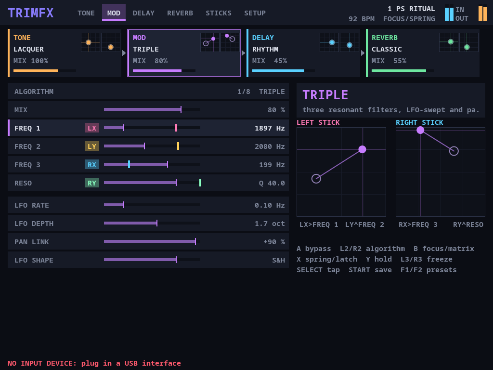

# TrimFX

A four-module FX chain for the **TrimUI Brick Pro**, built for a **USB FX send**: plug a USB
audio interface into the top port, send into its input, take the return from its output.
Both analog sticks play the effects as two X/Y pads. It also runs on the Brick and Brick
Hammer, which have no sticks, so they use the buttons and the STICKS page.

```
USB in -> TONE -> MOD -> DELAY -> REVERB -> USB out
          (mastering    (unusual   (granular,   (90s-style
           / character)  modulation) rhythmic,   algorithms)
                                     reverse...)
```



**Status: 0.1.0 dev.** The engine is tested on the host (every algorithm, `make test`), and the
app builds for MustardOS. It has **not yet run on Brick hardware.**

- Every module has several **algorithms** (L2 / R2). Each algorithm has its own controls, and each
  remembers its settings.
- Every module's **MIX** goes to **100 % wet**, with no dry at all, and **SETUP > DRY IN RETURN**
  defaults to off. The return carries only the effect.
- **DELAY and REVERB bypass with trails**: the input closes and the tail rings out.
- **FREEZE**: L3 holds the delay, R3 holds the reverb, forever, with the input closed.
- The chain order of MOD, DELAY and REVERB can be changed (SETUP > ORDER). TONE always comes
  first.

## The sticks: dual X/Y

Each algorithm has 8 parameters. **The first four are the PERFORM set** and sit on the sticks:

| | X (left / right) | Y (down / up) |
|---|---|---|
| **Left stick** | P1 (LX) | P2 (LY) |
| **Right stick** | P3 (RX) | P4 (RY) |

- **FOCUS** mode (the default) puts the sticks on the module whose page you are on. On the
  STICKS or SETUP pages they stay on the last module page.
- **MATRIX** mode (B) puts each axis on up to **two parameters anywhere in the chain**, each
  with its own depth (-100 % to +100 %). For example, LX could open the resonators and darken
  the tone at once, and RY could lengthen the reverb and push its mix. Set this up on the
  STICKS page.
- **SPRING** (the default) gives an offset while you push, and the value springs back when you
  let go. **LATCH** (X) drags the stored setting itself, which stays where you leave it.
- **HOLD** (Y) freezes the sticks where they are, so you can let go and keep the sound.

On screen, each module page has **two live X/Y pads**: a ring shows the stored setting, a dot
shows where the sticks have taken it, and a line joins them. Every slider shows the stored
value and the live one. The chain strip at the top has a small X/Y pair for every module, so you
see every effect's position at once. On the Brick Pro, the stick rings light up as you push.

## Controls

| Button | Action |
|---|---|
| L1 / R1 | Page: TONE · MOD · DELAY · REVERB · STICKS · SETUP |
| L2 / R2 | Previous / next algorithm of the module in focus |
| D-pad ↑↓ | Select a row |
| D-pad ←→ | Change it (hold to speed up) |
| A | Bypass / un-bypass the module (on SETUP rows: do it) |
| B | Sticks: FOCUS ↔ MATRIX |
| X | Sticks: SPRING ↔ LATCH |
| Y | HOLD the sticks |
| L3 / R3 | FREEZE the delay / the reverb |
| SELECT | Tap tempo (RHYTHM, STUTTER) |
| START | Save to the current preset slot |
| F1 / F2 | Previous / next preset slot (an empty slot loads a factory preset) |
| MENU | Quit (the state is saved and comes back next time) |

## The modules

The first four parameters of every algorithm, in **bold**, are on the sticks.

### TONE: mastering and character

| Algorithm | Parameters | What it is |
|---|---|---|
| LONDON | **TILT, FILTER, COLOUR, CRUSH**, TONE, GLUE, LOUD, WIDTH | 60s studio master: warm shelves, slow tube glue, transformer |
| PUNCH | same | NY punch: big lows, fast bus compressor, parallel squash, clipper |
| CLEAN | same | modern: tilt, 3-band glue, saturated air band |
| LACQUER | same | cutting room: warm curve, mono bass, tamed top |
| CASSETTE | **SATURATE, WOW, AGE, DROPOUT**, TILT, HISS, BIAS, WIDTH | worn tape |
| SAMPLER | **BITS, RATE, FILTER, RESO**, DRIVE, JITTER, TILT, WIDTH | old 12-bit sampler: aliasing, jittery clock, resonant filter |
| TUBE | **DRIVE, WARMTH, AIR, SAG**, BIAS, MIDS, TILT, WIDTH | asymmetric triode stage that breathes under load |
| FOLD | **FOLD, SYMMETRY, TONE, BLEND**, RECTIFY, SUB, TILT, WIDTH | wavefolder, rectifier, sub-octave |

The four mastering chains are the engine from [SP-1 Master](https://github.com/sydilaxe/SP-1Master-dev).
Each runs a look-ahead limiter, and FILTER / CRUSH come from its crush page.

### MOD: unusual modulation

| Algorithm | Parameters | What it is |
|---|---|---|
| TRIPLE | **FREQ 1, FREQ 2, FREQ 3, RESO**, LFO RATE, LFO DEPTH, PAN LINK, LFO SHAPE | Korg PS-3100 / 3200-style resonators (below) |
| BARBERPOLE | **SPEED, RESO, DEPTH, STEREO**, STAGES, CENTRE, DRIFT, NOTCH | an endless phaser: the notches rise (or fall) forever |
| SPIRAL | **SHIFT, FEEDBACK, TIME, SPREAD**, LFO RATE, LFO DEPTH, TONE, RING | a frequency shifter in a feedback delay: each repeat shifts again |
| CHOIR | **VOWEL, RATE, DEPTH, RESO**, THROAT, DRIFT, DRIVE, STEREO | an a-e-i-o-u formant morph that breathes and drifts |
| DRIFT | **DEPTH, RATE, VOICES, SPREAD**, WANDER, FEEDBACK, TONE, BASE | six wandering tape voices |
| ORBIT | **SPEED, RADIUS, SHAPE, SATELLITE**, DISTANCE, WIDTH, WOBBLE | the sound circles you, with Doppler, distance and a counter-rotating satellite |
| LIQUID | **SPEED, INTENSITY, THROB, VIBRATO**, CENTRE, FEEDBACK, STEREO, WARMTH | a photocell vibe whose lamp glows and fades unevenly |
| TIDE | **RATE, DEPTH, ENV>RATE, HARMONIC**, CROSSOVER, SHAPE, PAN, ENV>DEPTH | a harmonic tremolo that speeds up (or deepens) as you play harder |

**TRIPLE** follows the PS-3100 / 3200 resonators:
- Three resonant band-passes in parallel. Each resonator's resonance is held back by a soft,
  diode-like limit, as in the KORG-35 filters on the PS-3200 voice card.
- Each resonator is voiced a little differently, after the card's COLOR resistors
  (120k / 100k / 82k).
- One LFO sweeps all three, a third of a cycle apart. The **same LFO value moves each resonator's
  place in the stereo field**, by the **PAN LINK** amount:
  - 0: they sit fixed left, centre and right.
  - Positive: the pan follows the sweep.
  - Negative: the pan moves against the sweep.
- LFO shapes: sine, triangle, square, sample-and-hold, drift.

### DELAY

| Algorithm | Parameters | What it is |
|---|---|---|
| GRANULAR | **TIME, FEEDBACK, PITCH, DENSITY**, SIZE, SPRAY, REVERSE, SPARKLE | a grain cloud from the delay memory: pitch, spray, reverse grains, octave sparkle |
| RHYTHM | **DIVISION, FEEDBACK, PATTERN, TONE**, SWING, SPREAD, WOBBLE, DIFFUSE | tempo-synced tap patterns, from echo and ping-pong to clave, euclid and cascade |
| REVERSO | **TIME, FEEDBACK, DIRECTION, SMEAR**, DRIFT, TONE, SPREAD, SWELL | forward and reverse heads: the repeats flip direction, smear and swell |
| TAPE | **TIME, FEEDBACK, HEADS, WOW**, FLUTTER, AGE, DRIVE, SPREAD | a three-head tape echo; feedback past unity is caught by the tape |
| SHIMMER | **TIME, FEEDBACK, INTERVAL, SHIFT**, TONE, DIFFUSE, SPREAD, DRIFT | every repeat climbs (or falls) an interval |
| CLOUD | **TIME, FEEDBACK, DIFFUSION, MOD**, TONE, SPREAD, BLOOM, DUCK | four cross-coupled wandering echoes that bloom into haze and duck as you play |
| STUTTER | **DIVISION, CHANCE, REPEATS, PITCH**, REVERSE, DECAY, GATE, SPREAD | a beat-repeat that catches slices on the grid, pitches them and flips them |
| DUB | **TIME, FEEDBACK, FILTER, RESO**, TYPE, DRIVE, SPREAD, WOBBLE | a dub echo through a filter that morphs from low-pass to band-pass to high-pass |

### REVERB: late-80s / 90s algorithms

Every algorithm except MIDIVERB has **PRE-DELAY** (up to 500 ms) and **COLOR**. COLOR sets the
converters' era: 70s (narrow band, few bits), 80s, 90s, then NOW (full band).

| Algorithm | Parameters | What it is |
|---|---|---|
| CONCERT | **DECAY, SIZE, DAMP, MOD**, PRE-DELAY, COLOR, BASS, DIFFUSION | a Lexicon-style figure-eight hall tank with "spin and wander" chorus |
| PLATE | same | the same tank, small, dense and bright |
| CHAMBER 8X8 | **DECAY, SIZE, DAMP, MOD**, PRE-DELAY, COLOR, EARLY, PATTERN | an early-reflection pattern (room, hall, cathedral, slapback) into an 8×8 Hadamard FDN |
| SPACE | **DECAY, SIZE, DAMP, MOD**, PRE-DELAY, COLOR, MODE, DENSITY | URSA Major Space Station-style recirculating taps: metallic, fluttering |
| CLASSIC | **DECAY, ROOM, HI DAMP, MOD**, PRE-DELAY, COLOR, EARLY, LOW CUT | 16 combs, a 7-tap early pattern and 3 diffusers |
| BLOOM | **DECAY, SIZE, DAMP**, PRE-DELAY, COLOR, DIFFUSION, TYPE | the adjustable Alesis MidiVerb II Bloom, which swells instead of starting dense |
| MIDIVERB | **TYPE, LOW CUT, HIGH CUT, WIDTH** | the MidiVerb II Bloom programs 45 / 49, emulated exactly |
| HALO | **DECAY, SIZE, DAMP, MOD**, PRE-DELAY, COLOR, SHIMMER, INTERVAL | shimmer: every pass climbs an interval |
| SPRING | **DECAY, TENSION, DAMP, WOBBLE**, PRE-DELAY, COLOR, DRIP, DRIVE | two dispersive springs: drips, wobble, tube driver |
| INVERSE | **TIME, SHAPE, DAMP**, PRE-DELAY, COLOR, DENSITY, SPREAD | non-linear: swells up (inverse) or is cut off (gated) |

## Presets

- **START** saves to the current slot (1-16) as `presets/slotNN.txt`, in plain text.
- **F1 / F2** step through the slots. An empty slot plays one of the 8 factory presets: DREAM SEND,
  ASCENSION, PS RITUAL, DUST TAPE, BLOOM CATHEDRAL, STATION CHANT, FULL WET CLOUD and MIRROR WORLD.
- The whole state, including the stick matrix, is kept in `state.txt` and comes back at the next
  start.

## Installing (MustardOS)

1. Get `TrimFX-mustardos.muxapp` from a release, or build it (`make package`).
2. Copy it into `ARCHIVE/` on the SD card.
3. Install it from **Applications > Archive Manager**.

You can also run `make install SD=/path/to/card`.

Plug the USB interface into the **top** USB-C port; use a powered hub if the interface draws
more than ~500 mA. The first USB capture and playback devices are picked automatically, and
SETUP > INPUT / OUTPUT chooses others. `launch.sh` lists the settings, such as a smaller buffer
for lower latency.

## Building

```bash
pip install ziglang==0.14.1
```

```bash
make package
```

```bash
make test
```

`make package` cross-compiles for the Brick (aarch64, glibc 2.28, against the firmware's own
SDL2) and writes the `.muxapp`. `make test` runs the engine tests. Also:
- `make desktop` builds for this computer (needs `libsdl2-dev`). Run it with
  `TFX_WINDOWED=1 build/desktop/trimfx`; the keyboard stands in for the buttons, and `i j k l`
  and the numpad act as the sticks.
- `make shots` saves screenshots of every page.
- `make wavs` writes a WAV of every algorithm on a test signal.

## Credits and licence

TrimFX is GPL-3.0-or-later (`LICENSE`). It builds on:

- **Conduit** (sydilaxe, GPL-3): the MidiVerb II Bloom emulation, exact and adjustable. That code
  follows thement's [midiverb_emulator](https://github.com/thement/midiverb_emulator) analysis.
- **SP-1 Master** (sydilaxe, MIT, `src/master/`): the four mastering chains.
- **Trimui-Brick-Resources / Jaffedrone** (sydilaxe): input, LEDs, performance log, drawing and
  font (Noto Sans Mono, OFL), the SDL2 headers and the build approach.
- **ClassicReverb RE-04** (AnClark, GPL-3): CLASSIC uses its reverse-engineered structure and
  constants (Kjaerhus Classic Reverb).
- **Ideas, not code**:
  - Jürgen Haible's PolyKorg / PS-3200 material and the PS-3200 voice card schematic (TRIPLE).
  - MAI_verb and HybridReverb2 (the hybrid early + FDN chamber).
  - Dattorro's published plate topology (CONCERT / PLATE / HALO).
  - Valhalla VintageVerb's idea of a "color" era control.
  - The URSA Major Space Station and Lexicon's spin-and-wander (SPACE, CONCERT).
  - PiPedal (snapshot-style preset recall).
