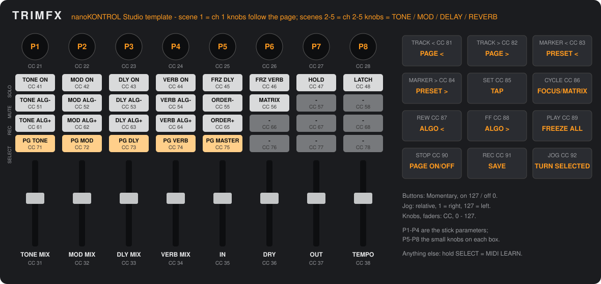
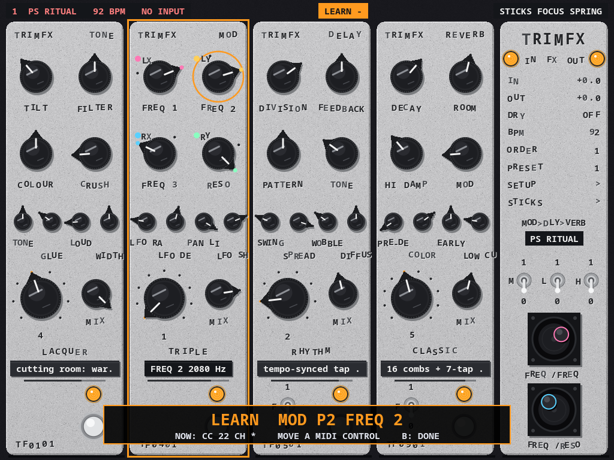

# TrimFX over MIDI: the TRIMFX template

TrimFX reads any class-compliant USB MIDI controller (through ALSA's raw MIDI devices,
`/dev/snd/midiC*D*`). Plug it in, with a hub if the audio interface is on the same port; it is found
within two seconds, and its name shows in the top bar (it flashes amber with each message). The map
below is built in and made for the **Korg nanoKONTROL Studio**. Other controllers work too: send
the same CCs, or use MIDI LEARN.



## Setting up the nanoKONTROL Studio (Korg KONTROL Editor)

The CC numbers below are this template's own, not the controller's factory scene, so write them to
the controller once with KONTROL Editor:

1. **Scenes 1-5**: set the scene's global MIDI channel to **1, 2, 3, 4, 5**.
   - Scene 1 (channel 1): the knobs move the box on screen (the one F1 / F2 or SELECT chose).
   - Scenes 2-5 (channels 2-5): the knobs are always TONE, MOD, DELAY, REVERB.
   - Everything else does the same thing on every channel.
2. **Knobs and sliders**: Control Change, 0-127, CC numbers as below.
3. **Buttons**: Control Change, **Momentary**, on 127, off 0. (A button in Toggle mode works only
   on every second press.)
4. **Jog wheel**: Control Change CC 92, the relative / Inc-Dec mode that sends 1 for a step right and
   127 for a step left.
5. Write the scenes to the controller.

## The map

| Control | CC | Does |
|---|---|---|
| Knobs 1-8 | 21-28 | P1-P8 of the box (scene 1: the one on screen, or its DEEP page while that is open; scenes 2-5: TONE / MOD / DELAY / REVERB). P1-P4 are the stick parameters, P5-P8 the small knobs. On channels 6-9 (a scene set to them) the same knobs move the DEEP settings of TONE / MOD / DELAY / REVERB |
| Faders 1-4 | 31-34 | MIX of TONE, MOD, DELAY, REVERB |
| Faders 5-8 | 35-38 | IN level (-24..+24 dB), DRY, OUT level, TEMPO (40-240 BPM) |
| SOLO 1-4 | 41-44 | Footswitch (on / bypass) of TONE, MOD, DELAY, REVERB |
| SOLO 5-6 | 45-46 | Freeze the delay / the reverb |
| SOLO 7-8 | 47-48 | Sticks: HOLD, LATCH |
| MUTE 1-4 | 51-54 | Previous algorithm of TONE, MOD, DELAY, REVERB |
| MUTE 5 / REC 5 | 55 / 65 | Previous / next chain ORDER |
| MUTE 6 | 56 | Sticks: FOCUS / MATRIX |
| REC 1-4 | 61-64 | Next algorithm of TONE, MOD, DELAY, REVERB |
| SELECT 1-5 | 71-75 | Show TONE, MOD, DELAY, REVERB, MASTER |
| TRACK < > | 81 / 82 | Previous / next page |
| MARKER < > | 83 / 84 | Previous / next preset slot |
| MARKER SET | 85 | Tap tempo |
| CYCLE | 86 | Sticks: FOCUS / MATRIX |
| REW / FF | 87 / 88 | Previous / next algorithm of the box on screen |
| PLAY | 89 | Freeze delay and reverb together |
| STOP | 90 | Footswitch of the box on screen |
| REC | 91 | Save to the preset slot |
| Jog wheel | 92 | Turns the control chosen on screen, like ←→ |

The knobs and faders jump to where they are (no pick-up). On an algorithm with fewer than eight
parameters, a knob without one does nothing.

## MIDI LEARN

**Hold SELECT for a second** (or SETUP > MIDI LEARN) to start learning. A banner at the bottom says
what will be learned and what it is mapped from now. Learning stays on, so a whole controller can be
mapped in one go:

1. Choose what to map:
   - a control on the board, with F1 / F2 and the D-pad: a knob, a slider, MIX, ALGORITHM, or on
     MASTER IN / OUT / DRY / TEMPO / ORDER / SLOT; or a setting on a DEEP page (open the page
     first, then hold SELECT);
   - or press the button whose job it should do: **A** the box's footswitch, **L3 / R3** freeze
     the delay / reverb, **X** LATCH, **Y** HOLD, **SELECT** tap tempo, **START** save,
     **L2 / R2** the box's previous / next algorithm.
2. Move a knob, fader or pad on the controller. That CC or note, on that channel, now does it.
   (It keeps turning the same thing while you turn it; choose the next control to learn another.)
3. **B** (or SELECT held again) ends learning.

A learned control always moves the same box. ALGORITHM learned from a knob chooses the algorithm across
the knob's travel. Learned from a pad, it steps to the next algorithm. A CC or note learned again
replaces what it did before.



The map is then kept in `midimap.txt` beside the app, one line per mapping, and can be edited:

```
# channel (1-16 or *), cc<n> or note<n>, action, module, value
* cc21 PARAM CHAN 0
2 cc7 MIX VERB 0
* note36 BYPASS DELAY 0
```

Actions: `PARAM` (value: parameter 0-7), `MIX`, `ALGO`, `ALGOSTEP` (value: -1 / 1), `BYPASS`,
`FREEZE` (0 delay, 1 reverb, 2 both), `MASTER` (0 IN, 1 OUT, 2 DRY, 3 TEMPO), `ORDER` (-1 / 1),
`PAGE` (-1 / 1), `PAGETO` (0-4), `PRESET` (-1 / 1), `SAVE`, `TAP`, `STICK` (0 matrix, 1 latch,
2 hold), `JOG`. Modules: `TONE`, `MOD`, `DELAY`, `VERB`, `PAGE` (the one on screen), `CHAN`
(by channel: 1 the one on screen, 2-5 TONE..REVERB), `-` for actions without one.
**SETUP > MIDI MAP** (A) deletes `midimap.txt` and goes back to the template.
